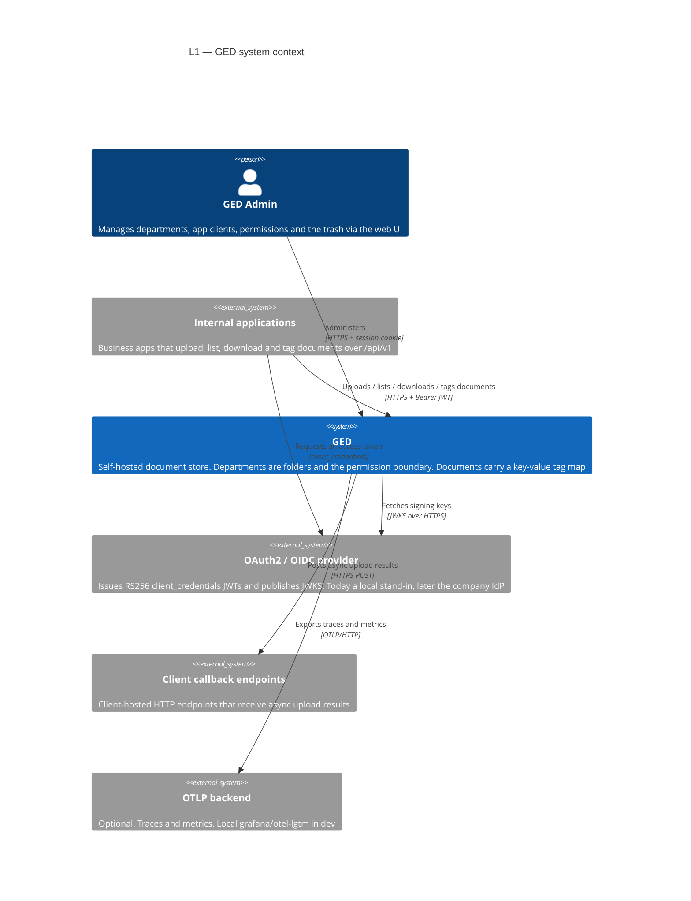
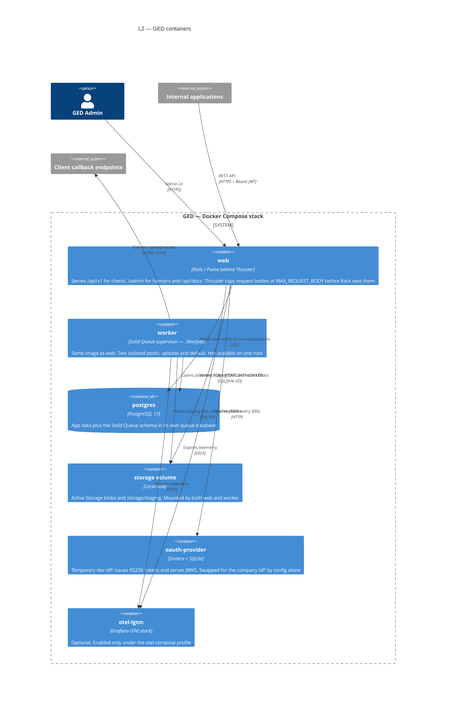
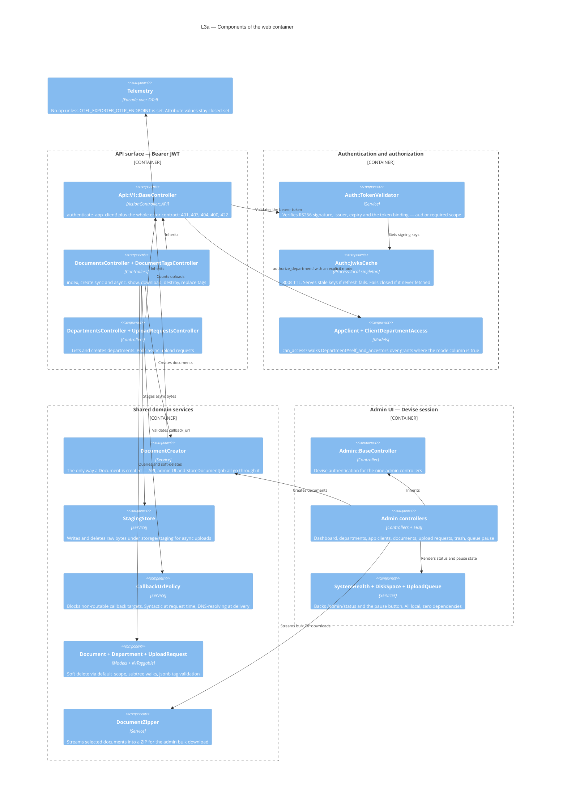
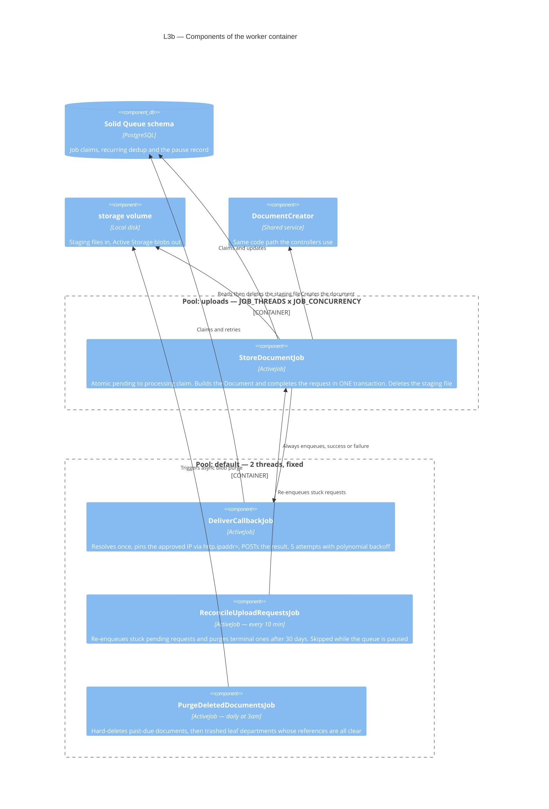
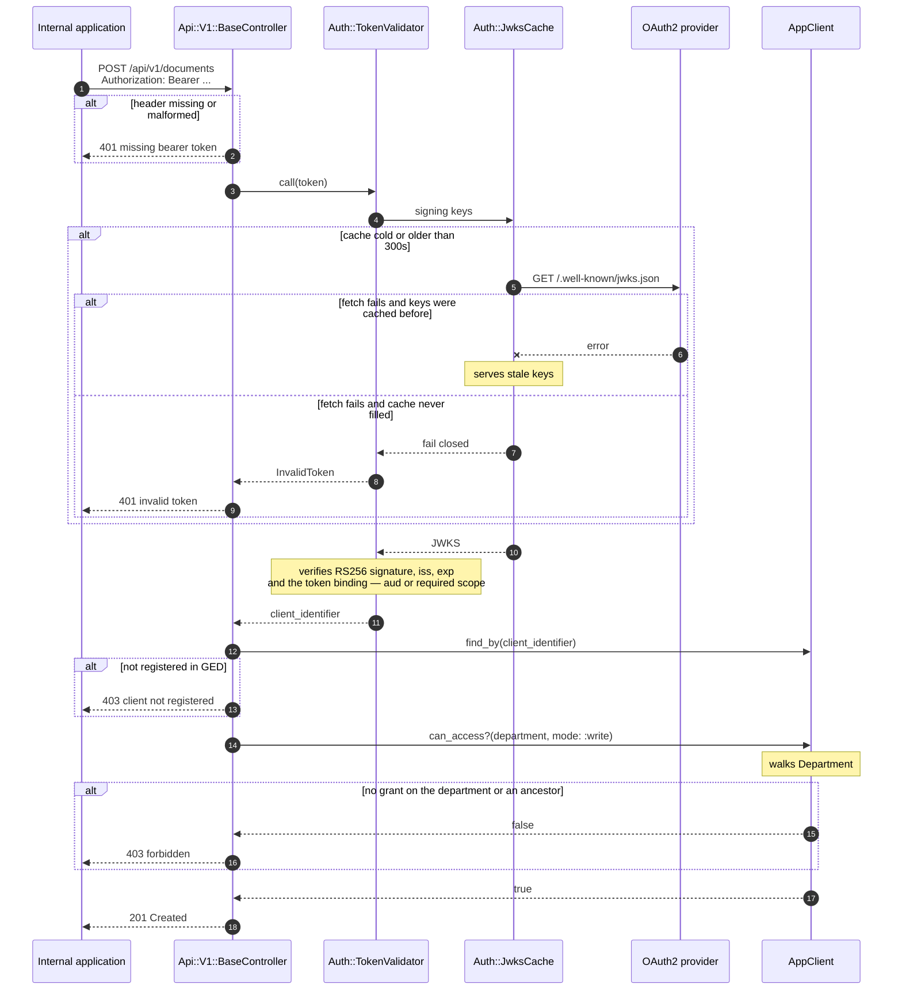
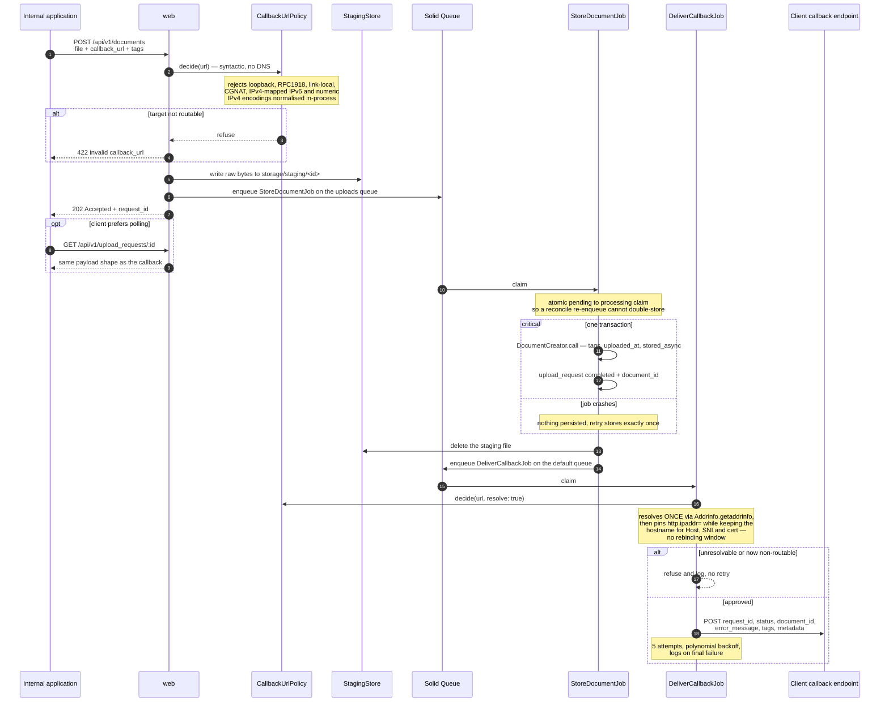
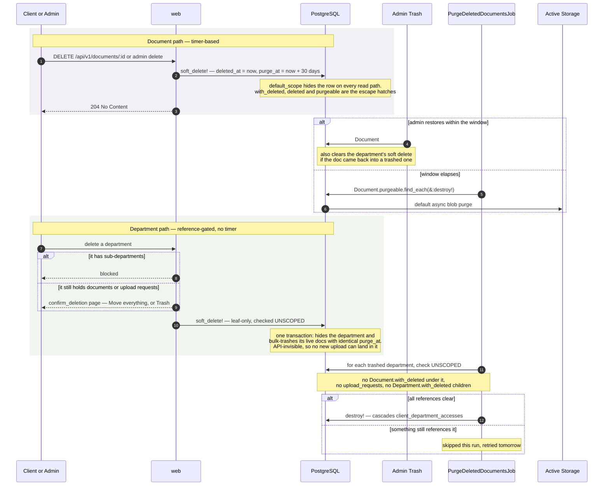

# GED — C4 architecture diagrams

A visual companion to `AGENTS.md` and the design specs in
`docs/superpowers/specs/`. The prose is the source of truth; these diagrams are the
map you read first.

Four zoom levels, following the [C4 model](https://c4model.com):

| View | Question it answers |
|---|---|
| [L1 — System Context](#l1--system-context) | Who talks to GED, and what does GED talk to? |
| [L2 — Containers](#l2--containers) | What runs, as which process, storing what? |
| [L3 — Components](#l3--components) | Inside `web` and `worker`, what are the moving parts? |
| [Dynamic views](#dynamic-views) | How do the three tricky flows actually unfold? |

All diagrams are Mermaid — they render on GitHub, in most IDEs, and in Claude
Artifacts, with no build step.

---

## L1 — System Context

GED is an internal, non-internet-facing document store. Its primary users are **other
applications**, not humans: they authenticate with OAuth2 client_credentials JWTs and
drive everything over `/api/v1`. A single admin persona uses the web UI to provision
departments, register clients, and grant access. Two outbound directions matter and
are easy to forget: GED **calls back** into client-hosted endpoints after an async
upload (the SSRF surface), and optionally **exports** telemetry.

> **Sources:** `docs/superpowers/specs/2026-07-08-ged-design.md`, `config/routes.rb`,
> `docker-compose.yml`.

**Read this way:** clients get a token from the IdP, then present it to GED; GED never
talks to the IdP about a specific token — it only caches the signing keys and verifies
locally. Client provisioning is *manual*: a client existing in the IdP is not enough,
an admin must also register its `client_id` in GED and grant department access.

---

## L2 — Containers

One deployable unit per Docker Compose service. The shape that matters most here is
the **shared `storage` volume**: `web` writes staging files that `worker` reads, and
`worker` writes Active Storage blobs that `web` serves. That coupling is why worker
scaling is same-host only.

> **Sources:** `docker-compose.yml`, `config/queue.yml`,
> `docs/superpowers/specs/2026-07-13-worker-scaling-design.md`.

**Notes worth carrying:**

- `worker` waits on `web` being healthy — only `rails server` runs `db:prepare`, so
  `web` must have migrated before a worker boots.
- `worker` scales with `bin/worktree-stack scale N`; replicas coordinate purely
  through Postgres, and recurring tasks are deduped by a unique `[task_key, run_at]`
  index, so N replicas do not mean N purge runs.
- `otel-lgtm` has deliberately **no** `depends_on` from `web`: with
  `OTEL_EXPORTER_OTLP_ENDPOINT` empty the SDK never loads, so ordering is moot.

---

## L3 — Components

### L3a — Inside `web`

Two entirely separate front doors sharing one Rails app: `Api::V1::BaseController`
(JWT, `ActionController::API`) and `Admin::BaseController` (Devise session). They do
**not** share controllers — the one thing they genuinely share is `DocumentCreator`,
the single path through which every document is created, including from the job.

> **Sources:** `app/controllers/`, `app/services/`, `app/models/`, `lib/telemetry.rb`.

**The authorization rule the diagram encodes:** `authorize_department!(dept, mode:)`
requires an explicit `:read` or `:write`. An unknown mode raises `ArgumentError` in
`granted_department_ids` rather than defaulting to `can_read` — a typo cannot silently
authorize a write through the read column. Read and write cascade independently down
the subtree, and **write does not imply read**.

### L3b — Inside `worker`

Four jobs, two pools. The absence of a `"*"` pool is the design decision here: Solid
Queue treats a queue list containing `"*"` as one global FIFO, so an uploads backlog
would starve callbacks and reconciliation. Explicit queues keep them isolated, and
`test/jobs/queue_coverage_test.rb` fails if a new `queue_as` is not listed.

> **Sources:** `app/jobs/`, `config/queue.yml`, `config/recurring.yml`.

---

## Dynamic views

### D1 — Bearer auth and department authorization

Every `/api/v1` request runs this. Note that nothing here calls the IdP per request:
key material is cached for 300s, and the cache deliberately serves **stale keys** if a
refresh fails, but **fails closed** if it never managed a first fetch.

> **Sources:** `app/controllers/api/v1/base_controller.rb`, `app/services/auth/`,
> `app/models/app_client.rb`.

### D2 — Async upload

Triggered purely by the presence of `callback_url` on the same
`POST /api/v1/documents` endpoint. The point of this view is the **exactly-once
boundary**: document creation and request completion share one transaction, so a crash
mid-job persists nothing and the retry stores the document exactly once. Job runs and
callback deliveries remain at-least-once.

> **Sources:** `app/controllers/api/v1/documents_controller.rb`,
> `app/jobs/store_document_job.rb`, `app/jobs/deliver_callback_job.rb`,
> `docs/superpowers/specs/2026-07-15-callback-ssrf-pinning-design.md`.

### D3 — Soft delete, trash and purge

Deleting is never immediate. Documents get a 30-day timer; **departments do not** —
they are purge-gated on their references being gone, which is why there is no
`departments.purge_at` column.

> **Sources:** `app/models/document.rb`, `app/models/department.rb`,
> `app/controllers/admin/deleted_documents_controller.rb`,
> `app/jobs/purge_deleted_documents_job.rb`.

---

## Deliberate constraints these diagrams encode

| Constraint | Why | Where it bites |
|---|---|---|
| `web` and `worker` share the `storage` volume | Staging files are written by web and read by worker; blobs are written by worker and served by web | Scaling is **same-host only**. Multi-host needs object storage first |
| No `"*"` queue pool | Solid Queue would collapse both queues into one global FIFO | An uploads backlog would starve callbacks and reconcile |
| Write does not imply read | The two grant columns are independent | A write-only client still gets the created document echoed back — that is the result of its write, not a read |
| Departments are the only permission boundary | Access covers the whole subtree, no per-subfolder rules | There is no finer-grained model to fall back on; grants never escalate upward |
| Token binding is mandatory | A shared company IdP issues tokens for every internal API under the same `iss` | At cutover, set `GED_OIDC_TOKEN_BINDING` to `audience` **or** `scope`; the app refuses to boot in production without the matching value |
| Client provisioning is manual | The real IdP's claim structure is unknown | A valid token from an unregistered client gets **403**, never auto-provisioning |

## Keeping this file honest

**This is enforced, not aspirational.** `test/integration/c4_diagrams_test.rb` fails
the suite when the model drifts from the code — exactly like `api_docs_test.rb` does
for the OpenAPI contract. It checks that every Docker Compose service, every
ActiveJob, every service object under `app/services/`, every recurring task in
`config/recurring.yml` and every Solid Queue pool in `config/queue.yml` is named
somewhere in this file. Add a job, and `bin/ci` goes red until L3b mentions it.

Deliberately *not* enforced, because the diagrams group them on purpose: the nine
`Admin::*` controllers, and the models. An over-strict test gets deleted rather than
satisfied — those stay on the honour system below.

Update these diagrams when any of the following changes — same rule as the OpenAPI
contract in `AGENTS.md`:

- a Docker Compose service, volume or scaling property → **L2**
- a new `/api/v1` endpoint, controller or service object → **L3a**
- a new job or a change to `config/queue.yml` / `config/recurring.yml` → **L3b**
- a change to the auth chain, the async upload pipeline, or the delete/purge
  semantics → the matching **dynamic view**
- the IdP cutover, when `oauth-provider` is retired → **L1** and **L2**
