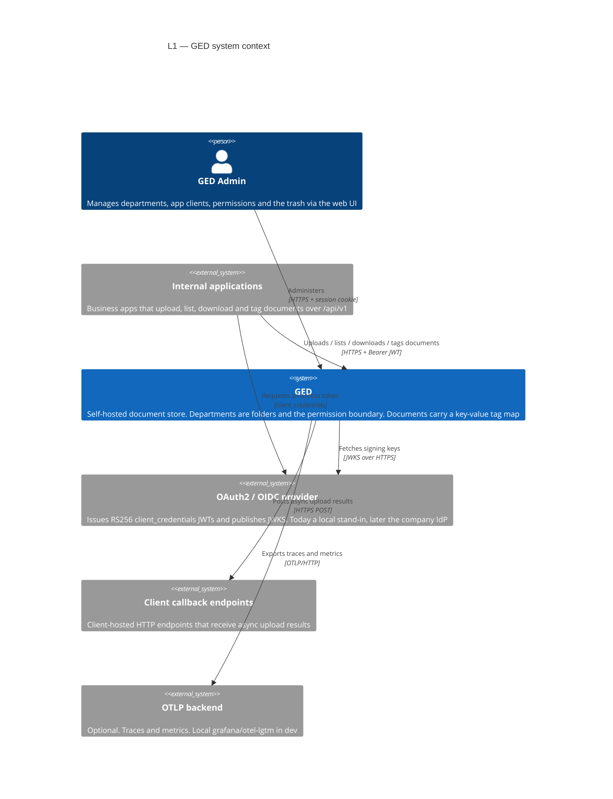
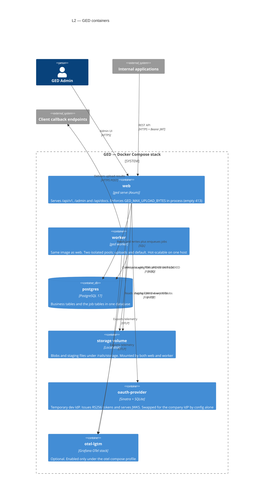
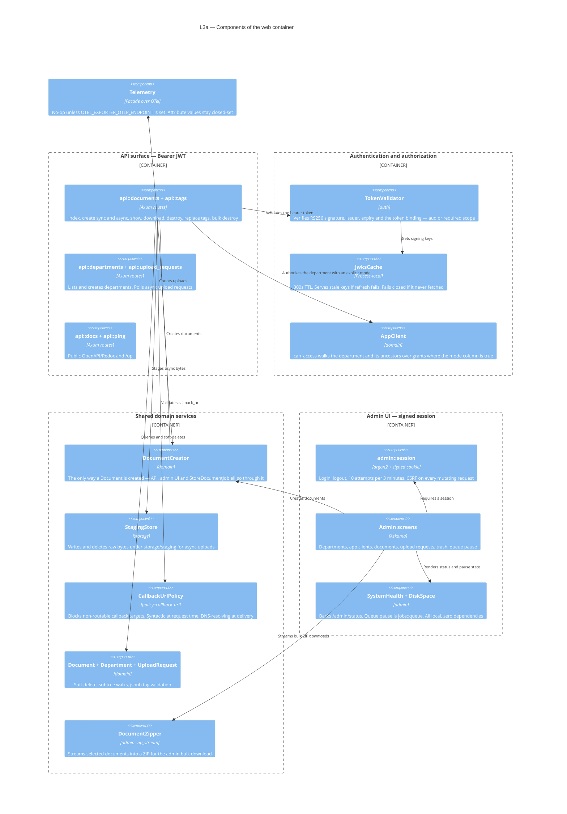
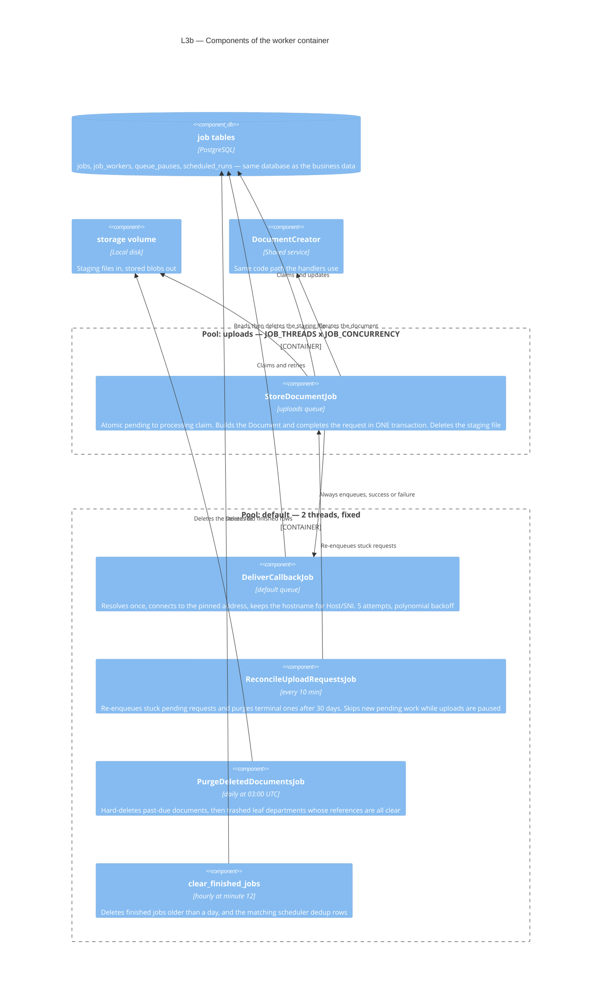
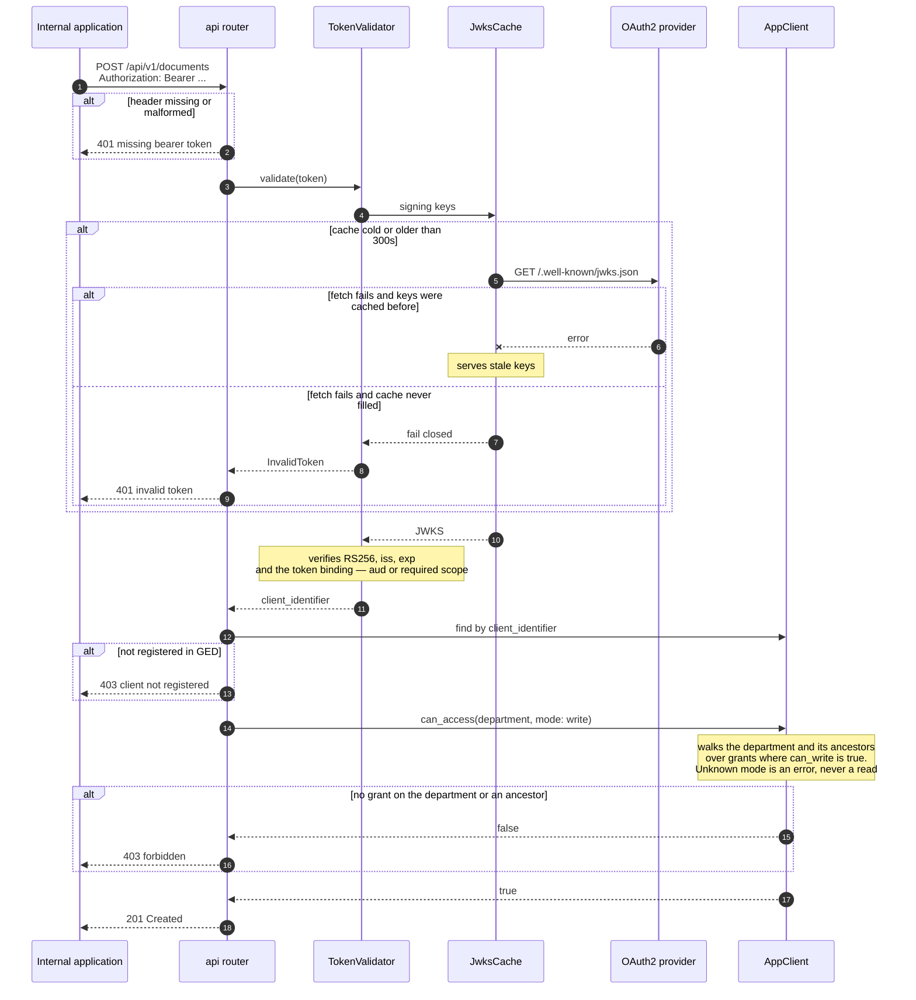
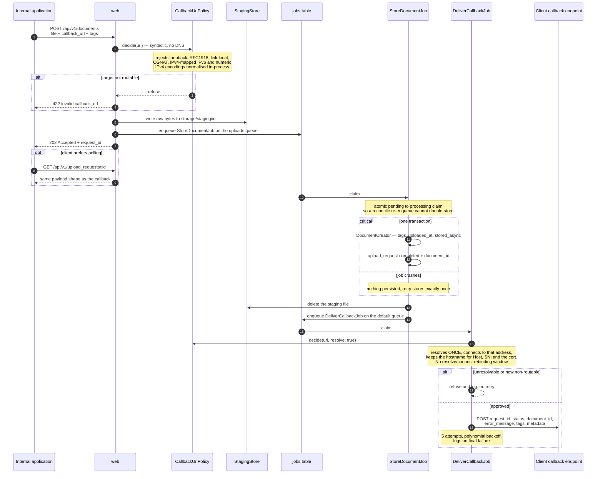
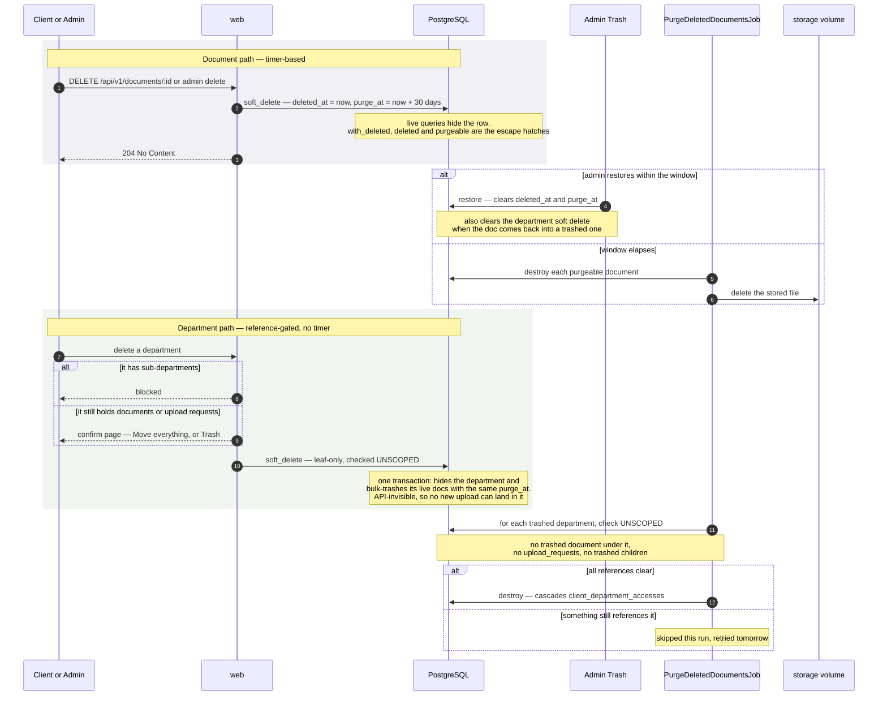

# GED — C4 architecture diagrams

A visual companion to `AGENTS.md` and the design specs in
`docs/superpowers/specs/`. The prose is the source of truth; these diagrams are the
map you read first. The running system is the Rust crate `ged` (`ged serve` and
`ged worker`). The Rails tree is the local tag `rails-final`.

Four zoom levels, following the [C4 model](https://c4model.com):

| View | Question it answers |
|---|---|
| [L1 — System Context](#l1--system-context) | Who talks to GED, and what does GED talk to? |
| [L2 — Containers](#l2--containers) | What runs, as which process, storing what? |
| [L3 — Components](#l3--components) | Inside `web` and `worker`, what are the moving parts? |
| [Dynamic views](#dynamic-views) | How do the three tricky flows actually unfold? |

All diagrams are Mermaid — they render on GitHub and in most IDEs, with no build step.

---

## L1 — System Context

GED is an internal, non-internet-facing document store. Its primary users are **other
applications**, not humans: they authenticate with OAuth2 client_credentials JWTs and
drive everything over `/api/v1`. A single admin persona uses the web UI to provision
departments, register clients, and grant access. Two outbound directions matter:
GED **calls back** into client-hosted endpoints after an async upload (the SSRF
surface), and optionally **exports** telemetry.

> **Sources:** `docs/superpowers/specs/2026-07-08-ged-design.md`,
> `rust/ged/src/api/`, `rust/ged/src/admin/`, `docker-compose.yml`.

**Read this way:** clients get a token from the IdP, then present it to GED; GED never
talks to the IdP about a specific token — it only caches the signing keys and verifies
locally. Client provisioning is *manual*: a client existing in the IdP is not enough,
an admin must also register its `client_id` in GED and grant department access.

---

## L2 — Containers

One deployable unit per Docker Compose service. `web` and `worker` are the same
image. `web` runs `ged serve`; `worker` runs `ged worker`. They share the `storage`
volume (`/rails/storage` — the path name is kept): `web` writes staging files that
`worker` reads, and `worker` writes stored blobs that `web` serves. That coupling
is why worker scaling is same-host only.

Jobs live in the **same** Postgres database as the business tables (`jobs`,
`job_workers`, `queue_pauses`, `scheduled_runs`). There is no second queue database.

> **Sources:** `docker-compose.yml`, `rust/ged/src/jobs/`, `Dockerfile`.

**Notes worth carrying:**

- Volumes are `pgdata`, `oauth_data`, `storage` and `lgtm_data`.
- The entrypoint runs `ged migrate` only for `ged serve`. `worker` waits on `web`
  being healthy, so the schema exists before a worker boots.
- `worker` scales with `bin/worktree-stack scale N`. Replicas coordinate through
  Postgres. Recurring tasks are deduped by a unique `(task_key, run_at)`, so N
  replicas do not mean N purge runs.
- `otel-lgtm` has deliberately **no** `depends_on` from `web`: with
  `OTEL_EXPORTER_OTLP_ENDPOINT` empty the SDK never loads.

---

## L3 — Components

### L3a — Inside `web`

Two front doors in one process: `api` (JWT, JSON errors) and `admin` (signed
session cookie, Askama templates). They do not share handlers. The thing they
share is `DocumentCreator`, the only path that inserts a document, including
from `StoreDocumentJob`.

> **Sources:** `rust/ged/src/api/`, `rust/ged/src/admin/`, `rust/ged/src/auth/`,
> `rust/ged/src/domain/`, `rust/ged/src/policy/`, `rust/ged/src/storage/`,
> `rust/ged/src/telemetry.rs`.

**The authorization rule the diagram encodes:** the mode is `:read` or `:write`,
and an unknown mode is an error rather than a silent fall-through to read. Read
and write cascade independently down the subtree, and **write does not imply read**.

### L3b — Inside `worker`

Four pipeline jobs plus `clear_finished_jobs` (hourly housekeeping on the default
pool), two pools. There is no `"*"` pool: a catch-all would collapse both queues
into one FIFO, so an uploads backlog would starve callbacks and reconciliation.
`rust/ged/tests/guards_queue.rs` fails if a queue is not drained.

> **Sources:** `rust/ged/src/jobs/`.

---

## Dynamic views

### D1 — Bearer auth and department authorization

Every `/api/v1` request runs this. Nothing here calls the IdP per request: key
material is cached for 300s, the cache serves **stale keys** if a refresh fails,
and it **fails closed** if it never managed a first fetch.

> **Sources:** `rust/ged/src/auth/token_validator.rs`, `rust/ged/src/auth/jwks_cache.rs`,
> `rust/ged/src/domain/app_client.rs`.

### D2 — Async upload

Triggered by `callback_url` on the same `POST /api/v1/documents`. Document creation
and request completion share one transaction, so a crash mid-job persists nothing
and the retry stores the document exactly once. Job runs and callback deliveries
remain at-least-once.

> **Sources:** `rust/ged/src/api/documents.rs`, `rust/ged/src/jobs/store_document.rs`,
> `rust/ged/src/jobs/deliver_callback.rs`, `rust/ged/src/policy/callback_url.rs`.

### D3 — Soft delete, trash and purge

Deleting is never immediate. Documents get a 30-day timer; **departments do not** —
they are purge-gated on their references being gone, which is why there is no
`departments.purge_at` column.

> **Sources:** `rust/ged/src/domain/document.rs`, `rust/ged/src/domain/department.rs`,
> `rust/ged/src/admin/trash.rs`, `rust/ged/src/jobs/purge.rs`.

---

## Deliberate constraints these diagrams encode

| Constraint | Why | Where it bites |
|---|---|---|
| `web` and `worker` share the `storage` volume | Staging files are written by web and read by worker; blobs are written by worker and served by web | Scaling is **same-host only**. Multi-host needs object storage first |
| No `"*"` queue pool | A catch-all pool would collapse both queues into one FIFO | An uploads backlog would starve callbacks and reconcile |
| Write does not imply read | The two grant columns are independent | A write-only client still gets the created document echoed back — that is the result of its write, not a read |
| Departments are the only permission boundary | Access covers the whole subtree, no per-subfolder rules | Grants never escalate upward |
| Token binding is mandatory | A shared company IdP issues tokens for every internal API under the same `iss` | At cutover, set `GED_OIDC_TOKEN_BINDING` to `audience` or `scope`; production refuses to boot without the matching value |
| Client provisioning is manual | The real IdP's claim structure is unknown | A valid token from an unregistered client gets **403** |

## Keeping this file honest

**This is enforced.** `rust/ged/tests/guards_c4.rs` fails the suite when this file
drifts from the code, the same way `rust/ged/tests/guards_api_docs.rs` does for
`docs/api/openapi.yaml` and `rust/ged/tests/guards_queue.rs` does for the worker
pools. The C4 guard checks that every Docker Compose service, every registered
job kind (including `clear_finished_jobs`), every service module that replaced
`app/services`, every scheduled task and every pool (`Pool: uploads`,
`Pool: default`) is named in this file.

Deliberately not drawn one-by-one: the admin screens (they are grouped) and the
domain models. `auth/authenticated_client.rs` is the request principal, not a
service module.

Update these diagrams when any of the following changes:

- a Docker Compose service, volume or scaling property → **L2**
- a new `/api/v1` route or a service module under `auth/`, `policy/`, or the
  files listed in `guards_c4.rs` → **L3a** and the OpenAPI spec
- a new job, queue, or scheduled task → **L3b**
- a change to the auth chain, the async upload pipeline, or delete/purge → the
  matching **dynamic view**
- the IdP cutover, when `oauth-provider` is retired → **L1** and **L2**
